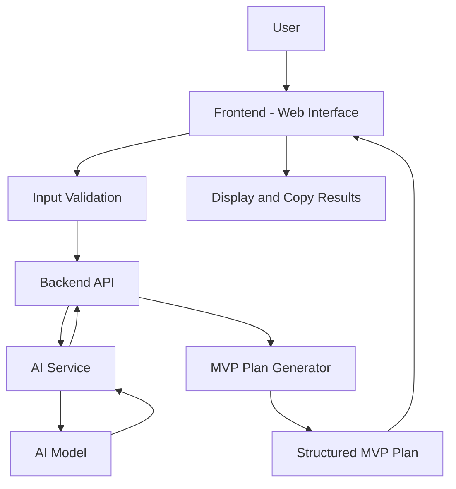

# System Architecture - AI-Powered Startup MVP Builder

## 1. Overview

The AI-Powered Startup MVP Builder is a web application that helps users transform startup ideas into structured MVP plans using artificial intelligence.

The system follows a simple client-server architecture.

## 2. High-Level Architecture Diagram

## 3. Main Components

### Frontend
- Provides the user interface.
- Allows users to submit startup ideas.
- Displays generated MVP plans.
- Provides options to copy results.

### Backend API
- Receives user requests.
- Validates submitted information.
- Communicates with the AI service.
- Processes and organizes AI-generated responses.

### AI Service
- Analyzes startup ideas.
- Identifies problems and target users.
- Generates and prioritizes core features.
- Suggests project constraints.

### MVP Plan Generator
- Combines AI-generated information.
- Organizes results into a structured format.
- Returns the final MVP plan to the frontend.

## 4. Application Workflow

1. The user enters a startup idea.
2. The frontend sends the input to the backend API.
3. The backend validates the submitted information.
4. The AI service analyzes the idea.
5. The AI model generates the required information.
6. The MVP Plan Generator structures the results.
7. The frontend displays the completed MVP plan.
8. The user can copy the generated results.

## 5. MVP Architecture Constraints

- No user authentication in the initial version.
- No permanent database storage is required.
- AI integration depends on an external AI service.
- The application supports basic MVP plan generation only.
