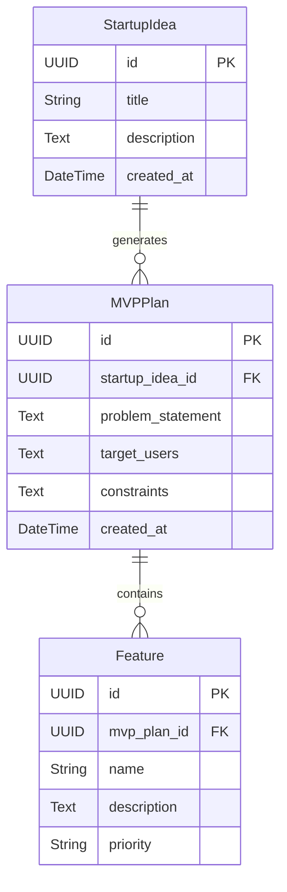

# Data Model - AI-Powered Startup MVP Builder

## 1. Overview

The data model defines the main entities required by the AI-Powered Startup MVP Builder.

The initial version uses three main entities: StartupIdea, MVPPlan, and Feature.

## 2. Entities

### Entity 1: StartupIdea

Stores the startup idea submitted by the user.

| Field | Data Type | Description |
| :--- | :--- | :--- |
| id | UUID | Unique identifier |
| title | String | Startup idea title |
| description | Text | Description of the startup idea |
| created_at | DateTime | Submission date |

### Entity 2: MVPPlan

Stores the structured MVP plan generated by AI.

| Field | Data Type | Description |
| :--- | :--- | :--- |
| id | UUID | Unique identifier |
| startup_idea_id | UUID | Reference to StartupIdea |
| problem_statement | Text | Identified problem |
| target_users | Text | Suggested target audience |
| constraints | Text | Project limitations |
| created_at | DateTime | Generation date |

### Entity 3: Feature

Stores the core features generated for an MVP plan.

| Field | Data Type | Description |
| :--- | :--- | :--- |
| id | UUID | Unique identifier |
| mvp_plan_id | UUID | Reference to MVPPlan |
| name | String | Feature name |
| description | Text | Feature description |
| priority | String | High, Medium, or Low |

## 3. Relationships

- One StartupIdea can have multiple MVPPlans.
- One MVPPlan belongs to one StartupIdea.
- One MVPPlan can contain multiple Features.
- Each Feature belongs to one MVPPlan.

## 4. Entity Relationship Diagram

## 5. Data Model Constraints

- Every entity has a unique identifier.
- Each MVPPlan must be associated with a StartupIdea.
- Each Feature must belong to an existing MVPPlan.
- Feature priority must be High, Medium, or Low.
- The initial MVP does not require permanent database storage.
